<div align="center">


**Fruit creatures run a smoothie mine. You run the business.**


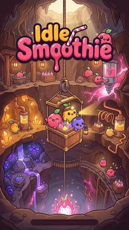
&nbsp;
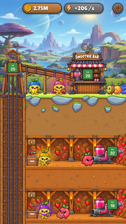

</div>

## Demo

https://github.com/user-attachments/assets/f9089463-8741-4447-ad47-e72194a86cee

<sub>A run from the first floor: tapping the stations, upgrading, unlocking floors and hiring managers.</sub>

## The game

Pulpies extract smoothie on 15 floors, in 5 fruit zones from strawberry to dragon fruit.
The elevator brings it up, and the Smoothie Bar sells it for coins.
Coins buy upgrades, new floors behind each zone's barrier, and managers that run a station on their own.

## The mine

<details>
<summary>Open the cross-section, from the surface down to dragon fruit</summary>
<br>
<div align="center">
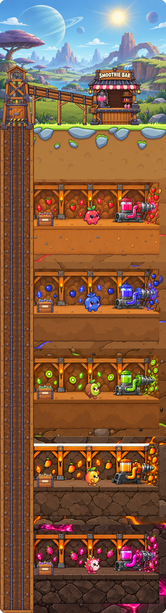
</div>
</details>

## Fruit zones

<div align="center">

| Strawberry | Blueberry | Kiwi | Mango | Dragon fruit |
| :---: | :---: | :---: | :---: | :---: |
|  |  |  |  |  |
| 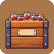 | 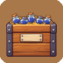 | 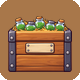 | 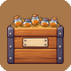 | 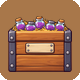 |
| 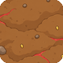 | 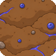 | 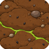 | 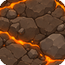 | 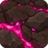 |

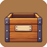<br>
<sub>Empty crate</sub>

</div>

## Managers

<div align="center">

| 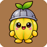 |  |  |  |  |
| :---: | :---: | :---: | :---: | :---: |
| Common | Rare | Epic | Legendary | Mythic |

<sub>Pulpies and managers: generated with ChatGPT, then cleaned and packed into sprite sheets by <code>tools/sprites.py</code>.</sub>

</div>

## Stations

<div align="center">

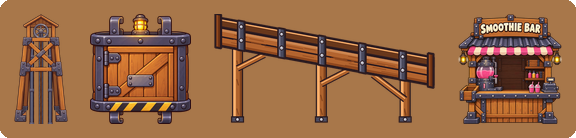


</div>

## How we built it

- **Design first:** a game design document and UML diagrams before the code.
- **Design patterns:**
  - Facade: `Game`
  - State: `PulpieState`
  - Template Method: `Station`
  - Strategy: `ManagerAbility`
  - Factory: `ManagerFactory`
  - Decorator: `PriceDecorator`
  - Memento: `GameSnapshot` and `SaveManager`
- **Model and view apart:** `model` and `core` never import JavaFX.
- **Tested class by class:** 361 JUnit tests, 98% coverage measured by JaCoCo.
- **Git flow:** one branch per feature, pull requests into `dev`, `dev` into `main`, Conventional Commits.
- **Build order:**
  1. A grey-box prototype of the floor, elevator and bar chain.
  2. The Pulpies.
  3. Upgrades.
  4. Managers.
  5. The save.
  6. The art, last.

## Play it

Install **JDK 21** and **Git**. The Gradle wrapper is included.

```sh
git clone git@github.com:EpitechBachelorPromo2028/B-OOP-301-MPL-3-1-2dgame-4.git
cd B-OOP-301-MPL-3-1-2dgame-4
make run      # or ./gradlew run
make test     # or ./gradlew test
```

On Windows: `gradlew.bat run` and `gradlew.bat test`.

## Team

<a href="https://www.linkedin.com/in/leo-bellard/"></a>&nbsp; Leo Bellard<br>
<a href="https://www.linkedin.com/in/mathis-monnin/"></a>&nbsp; Mathis Monnin<br>
<a href="https://www.linkedin.com/in/pornraksa-suksawaeng"></a>&nbsp; Pornraksa Suksawaeng
